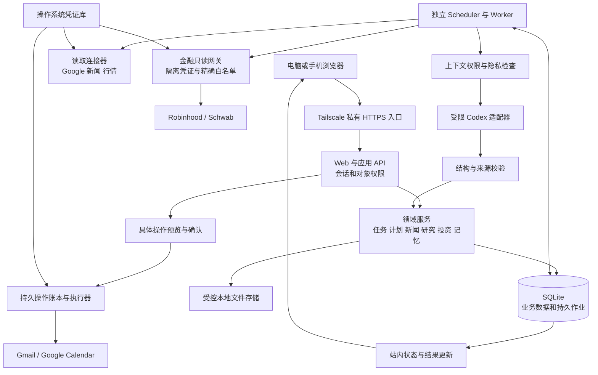
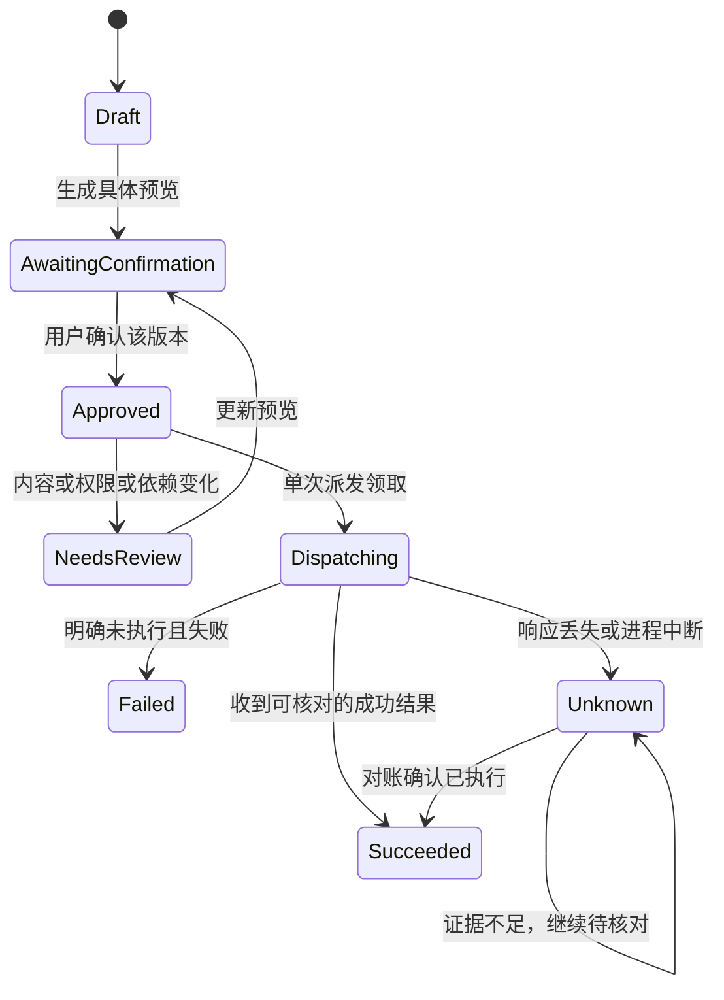

# 个人工作站系统设计

版本：1.13　日期：2026-10-13
状态：完整系统设计初稿，供审阅；产品边界已确认，技术选型为本设计建议，真实连接与运行能力尚未验收。

个人工作站以新闻、投资观察和长期研究为主要使用场景，同时统一管理个人工作、学习和家庭的邮件、日程、项目与待办。采用本机运行的模块化应用：业务数据、权限和确认记录由应用管理，独立后台负责同步与定时运行，AI 在获准的数据范围内生成分析和建议。

本设计覆盖已确认的第一版需求与未来家庭独立身份的基础结构，不是开发排期或实施完成说明。当前网页原型已经冻结保存，后续可以继续修改，不以原型目前展示的功能裁剪第一版需求。

## 1 设计依据与范围

优先级依次为：本次及此前用户明确决定、[已确认需求](requirements.md)、[新版原型设计](../prototypes/observatory-v2-design.md)、旧项目中可复用的设计思想。参考旧私人项目的系统设计（不随本仓库发布）；不继承旧项目的授权、部署状态、历史验收、时间配置或费用许可。

已确认：新建独立项目、选择性复用旧代码、审查后公开新仓库，旧仓库与历史数据保持私有（详见第 2 节）。外出访问使用 **Tailscale**；同一 Gmail 账户按用户确认的标签或规则划分工作、学习和家庭领域，未分类正文保守处理，不自动跨领域使用。

### 1.1 第一版必须覆盖

| 领域 | 能力与边界 |
|---|---|
| 今日动态 | 每日综合简报；重要变化、需处理邮件、日程和任务；站内提醒；随时追问 |
| 日程和待办 | 内部项目与任务、待整理收件箱、拆解建议、日计划容量与冲突；任务采纳、计划确认、外部写入分别决定 |
| 邮件与日历 | 单一个人 Google 账户的 Gmail 与 Google Calendar，包含家庭日历；本地处理状态独立；外部操作具体确认后执行 |
| 新闻热点 | AI、科技、宏观、地缘政治尤其中美关系、市场；事件聚合、来源核对、差异更新与更正撤回 |
| 投资观察 | Robinhood、Charles Schwab 普通及退休账户只读；持仓、现金、覆盖、可支持的收益与风险分析、资产配置和再平衡建议 |
| 研究跟踪 | 按长期主题组织，关联多个标的；新变化、前后判断、待验证问题、条件性标的影响、行动建议 |
| 个人化 | 已确认的长期记忆、领域授权、来源与运行设置、费用明细及预计月支出 |
| 运行与访问 | 电脑为主、手机辅助；关页后继续运行；主机离线可暂停；恢复补查；Tailscale 私人访问 |

金融分析包括个性化资产配置和再平衡建议；具体标的研究以事实、驱动和风险为主，不生成买入、持有、减仓等指令式建议，不执行交易或转账。原型暂未展示完整的财务分析、邮件和设置，不代表这些需求被移除。

第一版不加入银行、公司账户、Drive、Codex 项目观察、知识库、笔记编辑器、跨模块全文搜索、长期目标、定期复盘、复杂自动排程、完整多因素量化归因、独立运行管理控制台、站外推送或主机离线可用。家庭成员使用和选择性共享仅预留身份与数据结构。

### 1.2 原型保存

[当前 C v2 原型](../prototypes/dist/observatory-v2/index.html) 与 [设计说明](../prototypes/observatory-v2-design.md) 随本仓库保存。A/B/C 初版亦作为设计参考保留。

原始冻结快照、截图、校验清单与 ZIP 仅在不入 Git 的私人存档中保留；仓库副本移除个人称呼，不包含历史截图。原型中的价格、账户、来源、判断和状态均为虚构演示，不迁入真实业务数据库。新副本的文件清单见 [材料整理说明](material-inventory.md)。

## 2 从旧设计保留什么，调整什么

| 旧设计做法 | 新系统处理 | 理由 |
|---|---|---|
| 本地缓存加后台同步、API 不等待所有外部来源 | 保留 | 单源失败不拖垮打开页面和内部任务管理 |
| 来源事实、用户决定、AI 解释分开 | 保留并用于所有派生结果 | 防止同步或模型覆盖用户已确认内容 |
| 有版本的来源引用、增量游标、覆盖与新鲜度 | 保留 | 能说明结果依赖什么、哪些数据缺失 |
| 金融独立凭证域、逐项只读工具白名单 | 保留并同时限制进程和网络能力 | 上游工具服务可能具备交易能力 |
| 持久作业、租约、预算与权限检查、恢复围栏 | 保留 | 关页运行，重启不重复执行，撤销后迟到结果不恢复数据 |
| Google 来源 P0 只读，写入留未来 | 调整为本版确认后可执行 | 新需求明确要求站内确认邮件及日历操作 |
| Markdown 知识正文、Obsidian、Drive 与 Codex 项目观察 | 不加入 | 已明确排除；研究记录和长期记忆仍作为业务对象保存 |
| 旧五页、双主题和旧模板 | 替换为已选 C 及五个新入口 | 研究主题是核心，日程和待办内部包含项目 |
| 固定 07:00、旧研究周期、预算上限及旧连接范围 | 不继承 | 当前只确认每日简报、周中日内 30–60 分钟及逐项费用确认 |
| 旧版本、迁移编号、PR 与生产能力声明 | 不当作新系统能力 | 可复用思想不等于可直接迁移代码、数据或验收证据 |

### 2.1 已确认的新项目与复用路线

2026-10-12 已确认：新建独立项目，选择性复用旧代码，经审查后公开新 GitHub 仓库；旧仓库与历史数据保持私有。新项目建立自己的数据模型、权限边界和提交历史，不原地覆盖旧服务，不复制旧 `.git`、旧提交历史或私人运行数据。第一版不要求完整迁移旧项目业务数据，不以兼容旧数据结构为前提；旧数据继续在原私人环境保留，不执行删除。未来如确需接续有价值的记录，再单独审查选择性导入的范围、权限与隐私要求；完整迁移和通用导入工具不作为第一版交付前提。

复用以独立可审查的模块为单位，优先评估 Google 同步租约与撤销检查、Robinhood 只读工具校验、日计划可行性算法及相应测试。以上是候选，不是已通过新系统验收的实现。每个复用单元检查依赖、许可、个人化内容和新版契约；身份与领域授权、外部操作确认账本、长期主题研究模型按新需求建立，不为兼容旧结构重新引入已排除功能。

### 2.2 公开源码与私人运行隔离

| 边界 | 设计约束 |
|---|---|
| 公开仓库 | 仅放经审查的通用代码、通用文档、空配置模板及完全虚构的测试和演示数据；建立独立提交历史 |
| 私人运行数据 | 数据库、账户与持仓历史、私人研究、邮件、日程、模型会话、导出和备份存放在源码仓库外的受控目录；凭据使用独立凭证库 |
| 公开 CI | 使用 GitHub 托管的标准 runner 和虚构数据；不提供个人 Google、券商、AI 会话或 Tailscale 凭据，不连接私人运行主机；真实连接验收留在私有环境 |
| 日志与制品 | 构建日志、测试报告、截图、附件和发布包均不得包含真实个人或金融数据；忽略文件规则与密钥扫描不能代替内容审查 |
| 文档与演示 | 当前私人需求文档、系统设计、原型快照与 ZIP 不整体发布；公开材料去除个人身份、本机路径、私人链接和配置，金融样例重新构造为虚构数据 |
| 提交身份 | 公开账号、作者署名和提交邮箱在发布前确定，保护真实邮箱；隐藏邮箱不等于隐藏仓库所属账号 |

源码公开不改变第 15 节 Tailscale 私网、应用登录和对象权限的要求，也不公开工作站入口。旧仓库继续私有，不将其历史日志、Issues、PR 或附件搬入新仓库。

公开前审查候选文件、全部新提交、依赖许可、配置、演示素材和 CI 输出，验证未包含用户或他人的个人资料及真实金融数据。仅删除账号或姓名不构成金融数据脱敏；持仓组合、数量、成本、交易时间、金额及分析结果同样受保护。审查未完成时，候选内容保留在本地或私有环境。

新仓库用于 GitHub Actions 构建与测试的公开方向已确认；具体收费资源仍服从逐项费用确认，不将公开仓库理解为所有服务免费。独立仓库、材料整理和工程路线图已完成。2026-10-13 用户确认使用当前 GitHub 账号下的新仓库，在本次审查后公开，并保留未授予开源许可的状态。审查通过后新仓库已公开，提交保留通用署名；旧仓库可见性未改变，应用功能开发尚未开始。

## 3 总体架构

采用模块化单体代码库，运行时分为 Web/API、后台 Worker、受限 AI 执行器和连接器边界。第一版不引入微服务集群、Redis、向量数据库或外部任务平台。后台与 API 分进程，是为了关页运行和故障隔离，不是为了分布式扩容。



API 只读取本地投影或提交命令；同步和长分析返回作业 ID。模型不能直接改数据库、保存记忆、发送邮件、修改日历或访问券商工具。确定性代码负责权限、金额计算、状态转换、去重、版本冲突和最终执行。

### 3.1 建议技术栈

| 层 | 建议 | 选择原因与替换边界 |
|---|---|---|
| 前端 | React、TypeScript、Vite、查询缓存组件 | 将原型转为共享业务组件；保留当前视觉语言，不照搬演示状态 |
| 应用后端 | Node.js LTS、TypeScript、Fastify、运行时 schema 校验 | 与前端共享契约；业务模块不依赖具体 AI 或券商协议 |
| 主存储 | SQLite、WAL、受审 schema 迁移 | 单主机、小规模用户足够；短事务、单写协调、有界分页 |
| 长任务 | SQLite 持久队列与 Worker 租约 | 无额外常驻队列服务；恢复和去重可与业务提交同事务处理 |
| AI | 已确认可替换 `AgentRunner` 边界；Codex 优先，app-server 为候选路线 | 第一版单后台；接入与订阅须验证；更换服务、数据接收方、隐私条件或增加费用须确认 |
| 来源 | Google 官方 API；券商专用适配器；受限公开信息采集器 | 不把某个聊天中的连接当作独立应用已有授权 |
| 凭证 | macOS Keychain 或部署平台等效凭证库 | 数据库只存凭证引用；金融凭证与通用模型隔离 |
| 访问 | Tailscale Serve、应用会话、对象级授权 | 主机和手机私人访问；不使用 Funnel 公网入口 |
| 进程管理 | 本机系统服务管理器，macOS 可用 launchd | 页面关闭不影响运行；开机登录、Keychain 解锁和休眠影响需实测 |

这些是建议技术选择，不是已安装软件或版本承诺。实施时固定受支持版本与依赖锁文件。SQLite 数据库置于本机磁盘，不放到云盘同步目录或网络共享盘；若未来多主机写入或并发规模实测超过单机能力，再迁移 PostgreSQL，业务 ID、权限与服务契约不变。

## 4 页面与模块边界

| 入口 | 内容权威与主要动作 | 关联方式 |
|---|---|---|
| 今日动态 | 按用户展示综合简报、变化、待处理邮件、日程和候选任务 | 链接到原对象；不复制成另一套任务或判断 |
| 日程和待办 | 日历镜像、计划草案/确认版、候选任务、正式任务、个人项目 | 内部项目按工作/学习/家庭等组织；邮件处理详情在这里或今日动态打开 |
| 新闻热点 | 事件簇、来源版本、事实/冲突/更正/撤回 | 一条事件关联多个研究主题与标的 |
| 投资观察 | 持仓和关注、账户覆盖、风险/收益、配置建议 | 有效持仓派生研究对象；从标的查看多个相关主题 |
| 研究跟踪 | 长期主题、判断版本、开放问题、证据和条件性影响 | 从主题返回事件与标的，行动先进入待整理箱 |

权限、长期记忆、连接、费用、来源配置和数据生命周期放在设置或页内面板；简明运行记录在相关成果和状态面板打开，不增加第六个一级入口或独立工程控制台。

所有页面共享同一对象 ID 和权限层。助手请求携带当前对象 ID 与用途，由服务端重新选择上下文；浏览器传来的正文、权限或金额均不视为可信。助手的解释、提出任务、修改内部对象和外部操作四类意图分别处理。重命名或编辑任务、改变归属等用户显式内部命令可执行；AI 自发建议不能冒充用户决定。

手机支持查看简报、日程和待办、简单确认、追问；研究页提供顺序阅读与章节定位。复杂研究编辑、完整项目管理及设置仍以电脑为主。页面断线保留编辑草稿提示，但不承诺离线提交或缓存私人业务数据的离线副本。

## 5 数据权威、版本与基础模型

### 5.1 三种权威分离

1. **外部来源记录**：邮件、日历、证券账户、新闻、行情和披露。保留来源身份及版本；本地内容是镜像或摘录。
2. **用户决定**：任务状态与文字、项目、已确认计划、人工补充财务资料、已确认记忆、授权与具体操作确认。由应用数据库保存，不被新同步或新分析覆盖。
3. **系统解释**：分类、摘要、推测截止时间、建议安排、研究判断、风险解释和记忆候选。保留依据、版本、局限，可重算或纠正。

用户修订与模型建议分别存字段或版本。每个可修改对象使用稳定 ID 与乐观锁 `version`；冲突返回当前版本，保留用户编辑内容，不静默最后写入覆盖。领域重新分类、授权撤销和删除不是普通文字修改，必须传播到依赖对象。

### 5.2 核心实体

下表是逻辑模型，不规定最终建表代码。所有私人业务对象均带 `owner_id`、`domain_ids`、`visibility`、`version`、创建/修改时间；派生内容另带输入引用和权限依赖。

| 实体组 | 关键内容与约束 |
|---|---|
| User / Identity / Session | 稳定用户身份、多个通行密钥的凭据标识与公钥、会话及撤销状态、本地主机恢复记录；不存通行密钥私钥，不以邮箱作为跨系统主键 |
| DomainRule / Grant / ShareGrant | 规则优先级、来源范围、字段类别、用途、接收领域/用户、云服务路线、版本、撤销代际 |
| Connection / SelectedScope | provider、主体、选中资源、凭证引用、能力声明、授权状态、同步范围；预期范围不因失败缩小 |
| SourceItem / SourceVersion | 连接、外部 ID、对象类型、来源版本、内容 hash、发布时间/发生时间、首次发现、抓取时间、状态与字段缺口 |
| CoverageSnapshot / SyncCursor | 期望/已覆盖集合、查询窗口、分页完成度、字段质量、成功时间、检查时间、同步代际；不同窗口不得混用游标 |
| EmailAssessment / ProcessingDecision | 精确 message ID、线程 ID、候选事项、判断理由、用户纠正、本地处理状态；Gmail 已读独立 |
| TaskCandidate / Task / Project | 来源事项键、采纳关系、项目归属、优先级、状态、估时及依据；来源截止、推测截止、建议处理日期、用户日期独立 |
| DayPlan / PlanRevision / PlanBlock | 当地日期、时区、草案/确认版本、任务版本、日历覆盖版本、冲突与容量证据、可行性状态 |
| NewsArticle / EventCluster / Claim | 原始来源及转载关系、来源版本、事件成员、事实主张、冲突、修正和撤回；聚合可重新计算 |
| ResearchTopic / ResearchRevision | 核心问题、范围、来源策略、跟踪周期、系统判断版本、基线、本轮变化、把握程度、局限；不代表用户认可 |
| UserResearchView / ViewRevision | 用户确认的个人观点及独立版本、确认主体与时间、原文、可选的采纳来源判断版本；AI 不覆盖 |
| ResearchDivergence | 系统判断与个人观点的版本对照、重要分歧及证据、站内提示去重与查看状态；已查看不等于已采纳或已解决 |
| VerificationQuestion / EvidenceLink | 开放问题、需要的证据、判断改变条件、当前状态、证据/反证关系；问题完成不代表主题结束 |
| Instrument / TopicAssetLink / AssetImpact | 市场、资产类型、稳定标识、主题关联、作用方向、路径、时间、前提、未知与证据；ticker 不单独作主键 |
| ExpectedAccount / AccountSnapshot / Position | 券商与普通/退休类型、匿名账户键、币种、时间、现金/持仓、金额质量；一批快照有明确完整度 |
| CashFlow / PriceObservation / FXObservation | 入出金、收益计算所需历史、价格来源/时段/调整方式、汇率时点；字段缺失保留原因 |
| FinancialProfile / AllocationAnalysis | 用户目标、期限、风险承受、资金需求及更新时间；分析输入、范围、方法、假设和不足 |
| MemoryProposal / ConfirmedMemory | 候选和确认状态分开；依据、领域、用途、版本、修订/删除关系；继承来源敏感限制 |
| Briefing / Notification / ReadMarker | 简报日期与版本、分区质量；站内通知去重键；用户上次查看与系统上次成功更新分别保存 |
| Job / Run / RunInput / Output | 触发、计划时槽、任务类型、状态、租约、尝试次数、输入版本、结果、缺口、用量、权限快照 |
| ActionIntent / Approval / Attempt | 具体动作、目标、预览内容 hash、依赖版本、确认主体与有效期、唯一操作键、发送尝试、对账结果 |
| CostAuthorization / UsageLedger | 付费服务及计费方式、已确认范围、已预留与实际用量、估算/未知、供应商账单引用 |
| RetentionPolicy / DeletionRecord / AuditEvent | 数据种类、保留规则、删除/撤销屏障、清理结果、恢复重放所需记录；不保存完整敏感正文 |

来源唯一键至少包含提供方、连接主体、资源类型和外部 ID；同一券商不同账户、同一邮件线程的不同消息不能相互覆盖。索引、列表、简报、对话上下文都属于可能泄露信息的派生物，不能只保护原文表。

### 5.3 派生关系与失效

```text
来源版本 → 事实/解释 → 研究版本 → 标的影响 / 简报 / 任务候选
                         ↘ 记忆候选 → 用户确认记忆
任务候选 → 用户采纳 → 内部任务 → 计划草案 → 用户确认计划
                                   ↘ 外部操作预览 → 单独确认 → 操作账本
```

所有派生关系记录输入版本。来源被更正或撤回时，相关结论标为待复核或已失效，重新分析形成新版本，不覆盖旧历史。缺数据时维持“无法判定”，不生成“判断维持”的假结论。权限撤销使受限内容及派生物不可继续读取或作为上下文；用户自写部分保留，引用显示已不可用。

## 6 身份、领域与权限

### 6.1 六类权限分别判断

| 权限 | 判断内容 |
|---|---|
| 来源读取 | 哪个连接、账户、日历、邮件范围及字段可读 |
| 跨领域使用 | 哪些来源领域的数据可用于哪个目标领域及用途 |
| 云端 AI | 哪类数据可发给哪个服务、通过哪种路线、用于什么分析 |
| 外部执行 | 是否允许提出该动作；每次执行是否有匹配的具体确认 |
| 家庭共享 | 哪个接收者可看哪些对象/字段；默认为本人私有 |
| 长期记忆与费用 | 记忆保存和新增支出分别确认，不从其他权限推导 |

模型输入必须同时满足读取、用途、跨域、云处理以及有效授权版本。读得见不等于可以发云端，能分析不等于能执行。已授予的领域互通持续有效，日常同范围分析不重复询问；撤销、扩大范围或更换不等价服务路线才重新检查授权。

已确认的常用关系是新闻与持仓、工作和家庭日程可持续关联。工作邮件正文跨领域使用必须有单独授权。即使同属本人或同一 Google 账户，也不能绕开这一限制。

### 6.2 邮件领域划分

采用用户确认的 Gmail 标签、发件人/收件人规则及对象覆盖规则。推荐优先顺序：用户对单条消息的明确归类 > 用户确认的标签规则 > 用户确认的地址规则 > 未分类。规则只在工作站内解释，不擅自修改 Gmail 标签。

规则冲突或无法确定时进入 `unclassified`；默认不把正文或正文派生摘要用于跨领域分析。元数据也按其实际敏感性和用途检查，不能通过主题行泄露工作内容。一个线程可包含不同领域的消息，消息是最小授权判断单位。用户重分类只改变领域标签，不自动授予云处理或共享权限。

纯规则不需要云端模型。以后若启用分类建议，先取得该输入范围的云处理许可；AI 分类只是建议，不能自行扩大互通范围。

### 6.3 撤销与在途任务

撤销在一个事务中推进 `policy_epoch`、停止相关排队工作、使依赖缓存不可见，并记录清理任务。Worker 在取输入、云端派发、保存输出和读取结果时重新核对权限代际；旧代际的迟到结果不得写回、索引或恢复连接。

已经发送给外部服务的内容无法通过本地撤销收回；已经提交的邮件或日历操作也不能保证取消。此时立即阻止新的派发，对在途操作保留结果核对状态并说明边界。重新授权创建新的有效范围和代际，不自动复活旧的受限派生数据。

### 6.4 家庭扩展预留

数据库从第一天区分 owner、领域和接收者。未来家人使用独立应用身份；拥有 Tailscale 网络访问权不代表拥有应用数据权。共享指定任务或日程时建立受限投影，不自动共享源邮件、财务引用、私人备注、研究历史或关联对象。

派生结果默认继承所有敏感输入的限制，不能把“复制到家庭项目”当作脱敏。共享前必须明确选择可共享字段；第一版不开放家庭邀请和共享界面。

## 7 同步、来源覆盖与连接契约

### 7.1 统一来源输出

每次连接器读取输出 `schema_version、connection_id、scope_version、sync_generation、run_id、source_as_of、fetched_at、last_success_at、coverage、records、errors`。字段未知使用 `null + reason`，禁止补零或用本次检查时间冒充数据更新时间。

覆盖至少区分：完整、部分、过期、授权失效、失败、未知、未选择。成功检查但内容未变化、成功取到新内容、只取得部分内容是不同结果。单源失败只影响对应结果，不抹掉其他来源或内部数据。

分页数据先写暂存代际并保存检查点。达到完整扫描或完整增量链后，才原子发布有效集合与下一个游标；如果允许展示部分数据，则明确其范围并不声称整体完整。消息处理和任务用户状态不随源镜像重建而清空。

### 7.2 Google

Gmail 使用初次读取与后续 history 增量；历史游标失效时重新建立同步基线。Google 官方说明过旧 `startHistoryId` 可返回 404；这不是邮件已全部删除的证据。[Gmail 同步指南](https://developers.google.com/workspace/gmail/api/guides/sync)

Calendar 使用全量与 `syncToken` 增量；参数和选择范围与游标绑定。410 表示增量令牌失效，应重建外部镜像，但保留内部计划、用户决定和来源引用身份；暂存新集合完成后再切换。查询窗口外未返回的事件不视为取消。[Calendar 同步指南](https://developers.google.com/workspace/calendar/api/guides/sync)

日历完整集合与“今天所需的实例窗口”分开建覆盖证明。重复事件、例外、取消、全天事件、来源时区、夏令时和日历时区变化均参与可行性校验。事件时间统一保存 UTC 瞬间及 IANA 时区；全天事件保存日期与独占结束日期，不强行转换为有确定小时数的会议。

OAuth 仅申请实际功能所需范围，外部写入严格限制在第 9.1 节已确认的动作白名单；会议和重复事件的读取与写入权限分开处理。读取与执行权限分阶段申请，用户同意产品需求不等于 OAuth 已授权。只读授权时禁用外部写入并说明缺失权限；新增发送/事件写入范围通过正常授权流程完成。Google token 续期、测试应用限制和撤销需实测，不复制旧项目或桌面应用内部凭证。

### 7.3 Robinhood 与 Charles Schwab

金融连接器采用独立凭证和精确能力表：发现工具时过滤，调用时再校验工具 ID、参数 schema、账户范围和返回字段。默认拒绝新工具；不使用 `get_*` 名称匹配充当只读保障。通用 AI 不获得券商 MCP、连接器 shell、凭证文件或直连券商网络。

Robinhood 官方工具同时包括读取与交易能力，因此不能整体暴露给模型。普通及退休账户是否可见、历史与字段覆盖，以实际授权和逐账户测试为准。[外部代理说明](https://robinhood.com/us/en/support/articles/agentic-trading-overview/) · [工具说明](https://robinhood.com/us/en/support/articles/trading-with-your-agent/)

Schwab 优先评估官方个人开发者 API，经应用自有只读适配器使用；如选择第三方 MCP，需单独审查来源、固定版本、工具全集和底层 OAuth 能力。官方门户存在个人 API 与账户选择授权，但公开资料不足以证明所有退休账户和字段均可取得。[Schwab 开发者门户](https://developer.schwab.com/) · [OAuth](https://developer.schwab.com/user-guides/get-started/authenticate-with-oauth)

若底层凭证含交易能力，应用只读不能消除凭证泄露后的上游风险；授权前说明并核实可用的最小范围。金融操作不存在“用户确认后交易”的旁路。未连接的预期券商和账户继续显示覆盖缺口，不能用自选标的冒充已读取持仓。

### 7.4 新闻、行情与披露

来源配置记录领域、可信层级、原始/转载关系、获取许可、延迟、更新频率与费用。优先官方公告、论文、公司披露和可引用的可靠新闻；搜索结果用于定位材料，不能单独充当已读原文。

新闻与行情是独立来源。每项行情记录标的身份、交易场所、币种、交易时段、价格时间及复权方式。指数、个股、商品现货、期货和 ETF 不混作同一标的；商品合约换月和期限需要明确，缺少定义则暂停可比收益计算。

抓取器限制来源协议、重定向、目标网络、响应体大小、超时和解压量，拒绝本机、内网和云元数据地址；网页不能决定请求凭证或带出私人上下文。外部内容按许可保存必要摘录和引用，无法合法或稳定获取时显示缺口，不绕过访问限制。

## 8 邮件、项目、任务与日计划

### 8.1 邮件处理

Gmail 已读/归档状态、本地处理状态、候选事项状态和任务完成状态分别保存。邮件读过不代表已处理；等待回复不代表任务完成。用户可纠正筛选和行动判断、查看已同步范围内被筛除或已处理邮件、恢复处理，不因此修改源邮件。

候选事项去重键包含精确来源对象与事项身份，而非只有线程 ID。重复同步、重新分析、重复接受返回已有候选或任务；同一消息可包含多个独立事项，同线程的新消息重新判断。语义上相近的候选可建议关联已有任务，不能只凭文本相似自动删除新的独立事项。

收到的邮件正文采用第 16 节已确认的按需读取与 24 小时缓存规则。邮件同步保存必要索引、来源版本和处理状态，不建立长期正文镜像；回看正文时若缓存已过期，按当前权限重新获取，失败显示不可用而不返回过期副本。

本地生成的新邮件或回复是内部草稿，保存期限与收到的正文缓存分开确定。发送、回复或修改源日历进入第 9 节执行流程。第一版不固定邮件四分类；具体筛选规则可调整。归档、标为已读等操作按第 9.1 节已确认清单执行，永久删除不纳入第一版。

### 8.2 任务与项目

```text
系统提取 → 待整理候选 → 用户接受并选择项目 → 正式任务
                    ↘ 关联已有任务 / 不采纳
正式任务 → 未开始 / 进行中 / 等待 / 已完成 / 已取消
```

用户也可直接创建任务及项目；零散任务允许无项目。自动提取的候选按确认流程分配项目，或由用户明确保留为零散待办。任务拆解先生成候选，不能自行将项目宣告完成。项目完成由用户决定，任务数量统计只是进展信息。

日期字段至少分为来源明确截止及引用、系统推测截止及理由、建议处理日期、用户决定日期。估时区分用户提供、系统估计和未知。来源更正只标记影响和提出修订，不覆盖用户编辑；来源丢失后保留自写任务与已确认状态。

### 8.3 日计划

计划输入包含当地日历占用及覆盖、可用时段、缓冲、优先级、截止时间、任务依赖和已知估时。第一版采用可解释的排序与时间块建议，不做复杂优化器。缺少估时或日历覆盖时可保存草案，但标为可行性未核实；未知不是空闲。

确认日计划前重新核对依赖版本和新鲜度。只有覆盖足够且没有冲突才能标记“已核对可行”。用户可采纳带有显式未核实/冲突标记的安排，但这不改变其可行性结论；界面保留限制而不展示无条件绿色通过。

计划采纳、可行性核对和日历写入三个状态独立。已确认版成为不可自动覆盖的快照；新任务、日历变化或时区变更形成调整草案，并将原计划标为需复核。未经另行确认不移动原时间块。

## 9 邮件和日历外部操作

### 9.1 第一版操作范围（已确认）

2026-10-12 已确认执行范围如下。产品动作白名单独立于供应商 OAuth scope：即使上游授权允许更广动作，服务端仍只接受本表范围。

| 领域 | 允许的动作 | 不纳入第一版的动作 |
|---|---|---|
| Gmail | 撰写新邮件或回复的本地草稿；经具体确认后发送；对明确选定的消息归档、标记已读/未读、添加或移除已有标签 | 转发、附件处理与发送、批量操作、移入垃圾箱、永久删除、自动转发规则、创建/重命名/删除标签 |
| Google Calendar | 在选定且有写权限的日历中创建、修改、取消无其他参与者的单次事件 | 邀请他人、响应邀请、重复系列及其单次实例/例外的修改、修改日历共享权限 |

发送、归档、已读状态和标签变更均为外部操作，走相同的预览与确认账本；本地草稿与工作站处理状态不自动改变 Gmail，不增加 Gmail 草稿同步功能。标签操作不能通过更改垃圾箱等系统状态绕过删除动作限制。

读取与写入分离：获准读取的会议、重复事件和例外仍按第 7.2 节同步并参与第 8 节可行性分析。禁止修改重复事件同时覆盖其单次实例，不能通过编辑实例绕过范围；附件处理留在 Gmail，不自动下载附件给 AI。超范围动作向用户说明并提供返回原工具的入口，不生成可执行批准记录。

预览与派发前均校验精确动作、目标、权限及对象版本；日历需核对事件是否属于重复系列、是否包含其他参与者以及所选日历的权限。若确认后对象变为多人或重复事件，拒绝派发并提示原工具处理。已有共享日历的可见范围不因应用修改而消失，预览明确目标日历及已知共享影响，不承诺事件仅本人可见。

外部操作清单确认不等于 OAuth 已授权或功能已验收，具体 scope 与接口结果核对仍须验证。用户明确确认后发送邮件不属于站外主动提醒，不扩大自动通知范围。

### 9.2 操作协议

每次操作创建持久 `ActionIntent`，包含动作种类、连接、精确目标、收件人/日历、内容与差异、相关来源版本、幂等键。预览展示与执行相同的内容。确认记录绑定 actor、payload hash、目标版本及有效期；内容或目标改变、授权失效、确认过期均需重新预览确认。



确认是“执行这个具体动作”，不是对未来类似动作的长期许可。定时 Worker 不生成批准记录。金融动作不进入该状态机。执行器在派发前重查确认、权限和目标版本；取消只能阻止尚未派发的动作，已派发则进入结果核对。

### 9.3 去重与未知结果

内部账本通过唯一键和事务防重复点击、重复领取；外部服务无法与本地数据库组成同一事务，因此不承诺跨系统严格恰好一次。原操作结果未知时保留其账本和防重屏障，不能重置为可派发；用户知悉潜在重复后仍决定再次操作，必须创建关联原未知操作的新意图和新确认，原操作仍保持待核对。

Gmail `messages.send` 公开接口没有提供通用幂等键。发送成功但响应丢失时，状态为 `unknown`，先用已保存的消息标识、线程和发送记录核对；Message-ID 可辅助查找，但不当作服务端防重复保证。证据不足时不自动重发，保留待核对状态；用户确需再次发送时明确提示潜在重复并创建新的具体确认。[Gmail 发送接口](https://developers.google.com/workspace/gmail/api/reference/rest/v1/users.messages/send)

Calendar 创建采用稳定客户端 event ID，并在重复请求或响应丢失时读取并核对内容；修改/取消使用源版本或 ETag 条件检查。官方说明客户端 ID 可降低重复创建风险，但并非严格全局防重复承诺。预览明确冲突、目标日历和时区；重复事件及其他参与者的动作按第 9.1 节直接排除，不因预览确认而放行。[创建事件](https://developers.google.com/workspace/calendar/api/guides/create-events) · [事件 ID 约束](https://developers.google.com/workspace/calendar/api/v3/reference/events/insert)

邮件发送失败的重试、事件创建重试、OAuth 续期后的重试都走同一账本。恢复备份后保留“可能已执行”的动作，不重放已确认操作。

## 10 新闻与长期研究

### 10.1 事件与变化

采集到的文章先规范化来源与时间，再按事件聚合。多个转载不算多个独立证据；来源冲突分别保留。聚合结果有版本，错误聚合可在后端重算，不要求第一版增加手工拆分合并控制台。

每次变化对比基于同一选定范围的上次成功完整基线。部分运行可发布“已发现的新变化”，但不能推进未覆盖范围的基线或声称“没有新变化”。新闻发生时间、来源发布时间、首次发现时间、检查时间和用户上次查看时间分别保存。

变化类型包括新增事实、补充、来源修正、来源撤回、工作站摘要更正、判断改变、判断维持和无法判定。没有实质变化时沿用上一结论并记录检查；内部摘要更正不能包装成外部新证据。撤回传播到所有依赖的研究、简报和标的影响，历史版本仍可见但带失效状态。

### 10.2 主题与判断

长期主题拥有独立身份和核心问题，可跨 AI 技术、宏观、地缘政治及具体标的。主题与标的多对多，主题与项目通过行动关联。主题允许持续跟踪、暂停和归档，不以完成百分比衡量。

每个 `ResearchRevision` 至少包含：

| 内容 | 必须说明 |
|---|---|
| 比较基础 | 上次成功基线、本次覆盖、输入版本、时间与缺口 |
| 新变化 | 来源事实、原始出处、该事实为何影响或不影响研究 |
| 判断对照 | 上次/当前判断、维持/收窄/调整/无法判定、原因和把握程度 |
| 反证与未知 | 已观察到的反证与潜在反证分开；证据不足不伪装成反驳已成立 |
| 待验证问题 | 状态、需要的证据、什么结果会改变判断、相关事件 |
| 标的影响 | 传导路径、方向、期限、前提、未知与证据；区分持仓和关注 |
| 建议行动 | 进入待整理箱的候选，不自动改变任务和计划 |

2026-10-12 已确认采用系统判断与个人观点分开的模式：系统判断自动更新，个人观点由用户确认后保存，重要分歧仅在站内提示。

- `ResearchRevision` 保存有标签的系统分析。在已授权的主题、数据、调度和费用范围内，合格结果可自动发布，无需逐次审批；仍须通过第 12 节的输出与权限校验，覆盖不足时保留局限，不能以自动发布冒充已证实。只有实质变化新增版本。
- `UserResearchView` 及其版本是独立的用户决定。用户可采纳明确的系统判断版本、修改后确认，或自行记录观点；保存绑定用户实际确认的文本与版本。确认期间系统出现新版本，不把确认目标悄悄替换为最新判断。未保存观点不影响研究功能，普通对话、浏览及已读标记不能生成个人观点。
- AI 不覆盖用户观点。个人观点修改保留版本及确认时间，删除仍服从用户删除与派生清理规则；系统分析引用个人观点时保留出处，不将其当作外部事实。
- 重要分歧比较具体的系统判断与个人观点版本，展示证据、影响及待验证问题；核心假设受挑战可以构成提示依据，纯措辞差异不构成重要分歧。不得默认系统一方正确，证据不足时明确尚无法判定。
- 分歧在主题页及相关站内提醒中展示，按主题、比较版本和实质分歧去重；相同分歧重复检查不新增提醒，新的关键证据或实质变化可更新提示。查看状态与用户采纳、修改观点及分歧是否仍存在分别管理；不发送站外通知，不阻塞后续研究。
- 采纳个人观点不是正式任务采纳、日计划确认、外部操作批准或跨主题长期记忆确认，不触发交易或转账；对应流程仍独立执行。

把握程度采用有依据的定性说明，不制造概率或精确置信分数。用户追问继承当前主题与授权上下文；新的事实主张仍需证据，不能从对话流直接写成已证实结论。

### 10.3 深度与跟踪节奏

AI 和科技每日较详细汇总。宏观、地缘政治和市场默认简要，涉及持仓、关注标的或重大变化时深入。主题重大变化可在日内检查中进入站内提醒；不因普通科技新闻更新而反复生成整份日报。

重大变化判断由可配置规则和模型解释共同形成，例如正式政策阶段变化、重要披露、核心假设被证伪、行情超过用户设定阈值。每条提醒给出触发理由和依据；首版不预设未经用户同意的交易阈值。市场关闭、来源延迟和主题暂停状态参与调度，不把每 30–60 分钟检查等同于实时数据。

### 10.4 研究历史与必要证据（已确认）

2026-10-12 已确认长期保存研究判断及必要证据，默认不完整归档所有原文。研究判断版本、变化原因、支持与反证、待验证问题及其必要状态历史、许可允许的关键摘录或数据均保留至用户主动删除；主题暂停或归档只停止跟踪，不自动删除历史。

证据记录关联来源对象及版本、链接、发布时间/数据时间、获取时间、实际摘录或数据、支持/反对的判断及当前可用性。来源缺失的字段明确为未知；模型解释与原文摘录分开。系统保留足以理解当时判断的必要证据，不因采集或浏览就永久保存全文；同一来源版本的相同证据可复用引用。

新判断版本须有实质变化，如关键证据、判断或重要待验证问题状态变化、来源纠正或工作站自身纠错。无实质变化只记录检查结果，不产生重复判断版本；运行记录按自己的期限保存。研究基线仍遵守第 10.1 节的覆盖与成功条件，用户阅读不推进基线。

来源更正或撤回更新证据状态并传播到相关判断和标的影响；在允许范围内保留当时依据及更正关系，明确历史有效性，不能把旧证据继续作为当前事实。链接失效时仅能提供已保存且仍获准使用的证据，不保证完整原文重现。

研究证据继承来源的权限、敏感性和保留约束。邮件与金融证据到期、删除或撤销授权时，清理或限制相关摘录、派生内容和缓存，不因被研究引用而延长保存；必要的缺失标记不含受限内容。历史判断显示可核验范围，无法核验部分不自动改称错误或正确。研究历史保持私有，保存本身不授予额外云端处理权限。

普通新闻缓存、未纳入主题的材料及临时全文期限仍待确认，不纳入本条长期保存授权；默认不完整归档所有原文，不引入独立知识库。备份期限按第 16 节已确认规则执行，服务端副本删除与恢复核验仍待落实。

## 11 金融汇总、风险与配置建议

### 11.1 账户覆盖与快照

2026-10-12 已确认：第一版从接入时的当前账户状态及在已授权范围内可取得的历史开始，完整历史回填不作为启用或验收前提。每个账户分别记录实际历史覆盖期间、来源和缺口；当前成本、历史交易或现金流不可取得时保持未知，不能从当前快照虚构历史交易。历史不足时仍提供数据支持的当前观察，收益及归因遵守第 11.2 节限制。第 16 节的保留期限不等于初次接入必须补齐过去 5 年；后续补充历史也须遵守权限、来源及费用边界。

先由用户确定期望纳入分析的券商及账户清单，再对每个账户记录普通/退休类型、币种、授权、快照时间、缺失字段和同步质量。连接失效不能从分母悄悄移除账户；展示“已覆盖部分合计”时同时列预期与缺失范围。

账户读取一批完成后原子发布该账户快照。跨账户可以独立更新，但合计记录各快照时间及时间差，不把不同时点数据伪装成统一即时状态。现金、购买力、未结算资金、账户总值和仓位市值的定义由适配器明确，不能简单相加重复计数。

金额、数量和汇率使用十进制定点表示；币种、精度、单位独立保存。股票、基金、商品、期权合约乘数等按 Instrument 类型解释，不依据 ticker 猜测。无法支持的资产仍显示其缺口，不丢弃成零。

### 11.2 收益与价值变化

计算层先检验可比期间、历史持仓、现金流、价格、币种、公司行动、汇率和口径。方法及数据足够时才提供区间收益，说明使用时间加权或资金加权等具体方法；缺数据只显示可核对的价值变化和不足，不绘制假收益曲线。

```text
账户价值变化 ≠ 投资收益
价值变化可能包含：入出金、交易、分红费用、价格、汇率、公司行动、快照时差
```

风险层可给出已覆盖范围的集中度、资产类别/行业/币种/久期等暴露；无法取得分类或穿透信息时标未知，不强行补全。研究中的因果解释另引用公司披露、新闻和行情，券商快照本身不能证明涨跌原因。

### 11.3 个性化配置与再平衡

用户在使用时填写投资目标、期限、风险承受与资金需求；现金负债等银行之外信息可人工补充，注明用户提供及时间。缺少关键资料时先提出补充问题，不生成貌似完整的个性化配置结论。

输出包括适用账户范围、资料版本、目标配置区间、偏离与风险、再平衡考虑及不确定性。普通与退休账户分别考虑用户约束和已知限制，不推定税务待遇或替用户作税务优化承诺。配置建议与具体标的指令分开，不生成下单数量、交易票据或一键执行。

持仓研究对象从有效账户快照派生；自选清单只补充。无有效快照时可以继续公开主题研究，但持仓相关性标为未知/旧快照。不能用“支持降级展示”代替 Robinhood 与 Schwab 目标覆盖的最终验收。

## 12 AI 后台、上下文与不用于训练要求

### 12.1 独立应用与可替换 AI 后台（已确认）

2026-10-12 已确认：Codex 优先，工作站独立管理数据、权限和调度，预留 AI 后台替换能力；第一版不同时接入多个后台。该边界为已确认设计决定，不表示某条 Codex 接入路线、隐私条件或订阅能力已经通过验证。

业务数据库中的研究判断、个人观点、证据、任务、记忆、授权、操作账本和作业是应用权威；供应商会话 ID、临时工作目录和会话恢复状态只是执行器内部信息，不作为唯一业务存储或永久业务主键。上下文由应用按当前权限及版本重新组装，不能依赖复用旧会话来替代授权检查。

第一版仅实现并启用经验证的一条 Codex 分析路线；候选路线用于选择，不代表同时接入。公开研究与私人分析可使用同一后台的不同隔离配置，不因此增加第二个后台。预留统一接口及适配器边界，不建设多服务选择界面、自动故障切换或多模型协作平台。此限制针对 AI 分析后台，不取消 Google、券商及新闻等必要来源连接器。

更换后台时，保留应用数据、权限和调度契约，通过适配器处理认证、会话、模型能力、用量和错误差异；重新验证输出、工具隔离、隐私与费用。供应商会话不保证可直接迁移，必要时按获准的应用记录重建上下文。新服务或数据接收方启用前须获用户确认，不沿用旧服务专属的数据处理授权，也不自动开启额外收费路线。

AI 不可用时，主机在线且应用正常运行的情况下，内部任务与既有记录仍可用；应用调度继续管理作业状态，不依赖 AI 的同步仅在连接能力与权限允许时继续。AI 作业标为受阻或暂停并显示原因，恢复后按第 13 节合并补查，不自动改用其他后台。权限检查、金额计算和外部操作账本仍由确定性应用逻辑负责。

以下统一执行接口用于隔离 AI 适配器与业务模块：

`AgentRunner` 输入由服务端构建：任务类型、目标、获准来源片段及版本、已确认记忆、允许工具、输出 schema、超时及用量约束。输出包含结论、证据引用、未知、建议行动、usage 可见性和结束原因。

模型输出先做结构、引用存在性、数字口径、范围和权限检查，再保存为系统分析或候选。未通过校验只记录简明失败原因；模型称“成功”不等于作业成功，更不等于任务或项目完成。应用对话记录可保存，但不将其隐式转为长期记忆。

分离公开研究与私人分析执行配置。私人任务默认不使用任意网页/第三方工具；确需公开检索时先生成脱敏公共查询并再核对授权，不把原始邮件、账户号码或完整资产明细嵌进搜索词。主题名称、持仓代码和偏好本身也可能是个人数据，不能仅因删了金额就视作公开。

### 12.2 Codex 候选路线

下列是备选接入方式；第一版只选择并启用一条通过验证的分析路线，其余不同时接入或作为自动备用。

截至本次核查，官方文档说明原生 Codex 的 ChatGPT 登录使用订阅，API key 登录使用按量计费；app-server 支持托管 ChatGPT OAuth。选用前仍需在独立应用进程验证认证、恢复、模型可用性和用量边界。[Codex Authentication](https://learn.chatgpt.com/docs/auth) · [App Server](https://learn.chatgpt.com/docs/app-server)

| 路线 | 系统设计中的位置 | 前置条件 |
|---|---|---|
| 原生 Codex app-server 订阅登录 | 优先验证的本机执行器 | 官方支持的授权、隔离配置、后台运行实测、适用隐私与额度核验 |
| Sign in with ChatGPT 的自有应用接入 | 独立候选适配器，不与上一条混为一种认证 | 资格与预览限制、应用管理 token 的责任、该路线训练/留存政策明确 |
| API key | 可替换接口保留，但不默认启用 | 额外收费及服务条款逐项确认；不因订阅额度耗尽自动切换 |

SIWC 官方 app-server 指南描述使用计划 OAuth token 调用 Responses；预览要求 `store:false`、`stream:true`，本地 thread/resume 可保留。它不证明零留存，也不证明个人订阅适用普通 API 的全部数据政策。[SIWC 指南](https://developers.openai.com/siwc/token-sharing-open-source/codex-app-server) · [预览限制](https://developers.openai.com/siwc/token-sharing-open-source/preview-limitations)

本机 Scheduler 独立负责定时运行，不依赖 Codex 桌面自动化创建和管理作业。官方内置 Scheduled 对本地任务有电脑及桌面应用运行条件；它与本系统自行设计的队列不是同一个能力。[官方自动化说明](https://learn.chatgpt.com/docs/automations)

### 12.3 隐私准入条件

“数据不用于训练”是必须满足的要求，不是可降级的偏好。每个 AI 路线保存适用政策依据、核对日期、账户设置核验结果、允许数据种类、服务端留存与删除能力。在这些条件未得到确认前，只能用合成数据验证相关私人流程；不得发送个人邮件、财务明细、用户记忆或可识别的个人研究上下文。

个人订阅的训练开关、Codex 环境设置、反馈可能带来的例外，以及 SIWC 对应政策，需要按所选路线确认；现有订阅本身不是合规证明。普通 API 的 no-training 与留存说明不能直接套用到订阅 OAuth 路线。[API 数据控制的适用说明](https://developers.openai.com/api/docs/guides/your-data)

不要自动上传敏感会话反馈。服务条款或数据设置变化后使隐私核验失效，暂停受影响的私人模型调用，保留内部非 AI 功能并显示阻碍。若没有可满足要求的路线，则这一能力保持未验收，而不是默默改用付费服务或放宽要求。

Codex 的本地历史配置和删除命令只处理相应本地记录，不证明供应商远端副本已删除。模型临时工作目录、会话恢复数据、工具缓存和崩溃日志纳入本地生命周期；不能只关掉 `history.jsonl` 就称所有上下文不落盘。[配置参考](https://learn.chatgpt.com/docs/config-file/config-reference) · [本地命令](https://learn.chatgpt.com/docs/developer-commands)

### 12.4 模型隔离

执行器使用工作站专用配置和最小工具集，不继承个人 Codex 全部插件、MCP、项目目录或网络权限。凭证由受限连接器使用，输入只传必要字段和匿名账户键。去掉账户号码、登录信息、无关身份字段；需要跨段关联时采用运行内别名。

外部邮件、网页和模型生成内容都是数据，不能改变工具、收件人、权限、费用或执行政策。提示词隔离只是辅助，真正边界由工具禁用、文件/网络隔离、服务端 schema 和授权检查实现。若无法实测证明当前 Codex 工具模式满足隔离要求，不启用私人数据分析。

## 13 简报、调度、提醒与恢复

### 13.1 调度定义

| 工作 | 已确认行为 | 待配置项 |
|---|---|---|
| 每日简报 | 每天，邮件/日程/待办/新闻/投资各分区汇总 | 具体时间；首版不沿用旧系统 07:00 |
| 周中日内跟踪 | 用户选定时段每 30–60 分钟，支持手动刷新 | 周中具体日期、起止时间、30/45/60 分钟选择 |
| AI 与科技汇总 | 每日较详细 | 主题来源、重点排序 |
| 任务与日程提醒 | 独立规则，页面打开时可更新 | 提前量、逾期、全天事件与工作时段规则 |
| 来源同步 | 支持以上流程，遵守配额与实际源更新频率 | 每源频率与新鲜度阈值，不能假定每次都取得新数据 |

时间配置使用 IANA 时区，用户在初次配置时选择实际使用时区；保存规则而非固定 UTC 小时。夏令时重复/缺失时刻有明确策略，同一当地日期与计划槽最多产生一个逻辑作业，调整时区后重新计算未来时槽。

### 13.2 队列与结果

逻辑作业键包含 owner、任务类型、作用范围、计划时槽和策略版本；多次手动刷新与定时触发可合并为同一在途刷新。作业状态为 queued、running、succeeded、partial、failed、cancelled、blocked，重试作为同一逻辑作业的 attempt。

Worker 使用持久租约、心跳和领取代际。旧进程失去租约后，即使模型晚返回也不能提交。输入、权限、费用在派发前再次核对，输出和结果状态在短事务中发布。推荐初始每作业最多三次有界重试并退避，此为可调整技术参数，不自动购买额度。

交互追问优先于后台长研究；已确认的外部操作使用独立账本与串行限制，不与普通研究重试混用。配额不足、认证失败、费用未批准属于 blocked，不能无限重试。429 按服务约束退避；中断的分析可以重新生成草稿，但不能重放外部写入。

### 13.3 恢复与站内更新

主机休眠、关机、断网允许暂停。恢复后记录中断区间，按当前过期与缺失程度补查，将错过的多次检查合并，不逐槽补跑。收到过期响应、用户已暂停主题、来源已撤销等情况，丢弃不合格结果并解释原因。

简报分区独立发布成功/部分/失败，失败时保留上一有效结果并显示时间。运行记录提供触发、输入范围、起止、成果、未处理部分和原因；不保存整段邮件、财务明细或 token。运行成功、发现变化、用户接受、任务完成、项目完成是五种不同状态。

通知只在站内持久化；SSE 推送本机已授权状态变化，断线可重新拉取。重连事件按 ID 去重并重新鉴权；权限撤销时清除客户端受限缓存。浏览器关闭不发送系统推送、邮件或短信。用户下次打开按通知 ID 和读取标记展示积累的变化。

## 14 长期记忆与对话

系统可从使用行为提出记忆候选，明确内容、推断依据、适用领域和用途；用户确认后成为 `ConfirmedMemory`。修改创建新版本，删除立刻停止后续个性化使用，并使排队或活动作业的旧输入失效。

业务记录正常保存不需要伪装成记忆确认；反过来，不能因为保留了对话记录，就自动将其中的个人偏好当成已确认记忆。每次上下文组装重新查询当前有效记忆，不能用旧模型会话绕过删除。

对话按用户与权限上下文隔离，输出继承输入限制。撤销或删除后，含受限上下文的模型会话不继续 resume；需要时开启新会话并重新构建合格上下文。历史回答可以按策略隐藏或脱敏，用户自写内容保留其自有部分，不能继续暗中提供旧记忆个性化。

## 15 Tailscale 私人访问与应用安全

用户已确认使用 Tailscale。设计采用 Tailnet 内 HTTPS 入口代理本机 Web/API，服务端监听 loopback，Tailnet ACL/Grants 只开放给本人所需设备与身份。明确检查未启用 Funnel，不将任何私人页面发布到公网。Serve 的权限与 HTTPS 行为以官方说明为依据，实际配置需要单独实施验证。[Tailscale Serve](https://tailscale.com/docs/features/tailscale-serve)

2026-10-12 已确认采用通行密钥（Passkey）登录，支持备用凭据；所有登录凭据失效时，通过主机本地受保护流程恢复。应用仍有自己的 User 和 Session，不因请求来自内网或 localhost 就跳过授权；Tailscale 网络身份不独立取代应用身份及对象级鉴权。

一个用户可登记多个通行密钥；应用保存凭据标识、公钥及必要状态，不保存通行密钥私钥或生物识别数据。首次登记、添加备用凭据与撤销流程必须核验身份，不能开放匿名注册或任意账号重绑入口。设备/浏览器兼容性、稳定访问域名与通行密钥作用域需在接入前验证；系统同步密钥的使用另行配置，不默认要求购买硬件密钥。

用户可撤销丢失设备的会话，必要时替换或撤销相关凭据。同步通行密钥可能存在于多个设备上，不把一枚凭据等同于一台物理设备；会话撤销与凭据撤销分别处理。

所有凭据不可用时，恢复必须通过验证主机授权控制的本地受保护流程，由用户明确操作；网络来源为 loopback、Tailnet 身份或知道本机路径均不足以恢复。具体操作系统验证机制仍须设计与实测，不设置可由浏览器匿名调用的重置入口，不自动添加邮件、密码或第三方账号恢复通道。

恢复绑定原有稳定 User ID，不新建替代所有者或批量迁移业务数据；重新登记凭据并使旧会话失效。失效、丢失或已撤销的凭据不自动恢复为可用，现有领域限制、删除记录和外部授权状态保持有效。恢复登录不执行邮件/日历操作，也不恢复已撤销的 Google、券商或 AI 连接。

外出时如所有登录方式不可用，允许等待主机本地恢复。此决定只涉及身份恢复，不承诺恢复损坏主机的数据或遗失的备份解密密钥；异机恢复须另按第 16 节的备份、身份重建和权限核对规则办理。未来家庭成员使用独立身份，不共享本人凭据；第一版不增加多人管理界面。

会话 cookie 使用 Secure、HttpOnly 和合适的 SameSite；写操作校验 Origin/CSRF，WebSocket/SSE 同样认证。限制 Host、请求大小、登录尝试、连接器访问和 CORS。HTML 邮件/网页内容清理后显示，远程图片默认不加载，链接打开不携带应用 token。

浏览器不保存 OAuth token、券商凭证、完整金融数据或长期私人缓存到 localStorage。私人响应不进入公共缓存；日志、错误页和前端埋点不包含正文/账号。临时导出必须鉴权，不能以长期公开文件 URL 下载。

主机磁盘加密、专用数据目录权限、凭证库与加密备份形成基础保护。主机被完全攻破不能由应用只读网关兜底，金融凭证与 AI 隔离仍必须单独验证。Tailscale 不替主机保持在线；主机离线时电脑站点与手机访问均可不可用。

## 16 数据保存、删除、备份与导出

2026-10-12 已确认采用按数据类型分层保存，分别处理研究判断与必要证据、邮件正文、金融历史、临时 AI 输入和运行记录。金融历史、研究判断与必要证据、收到邮件正文 24 小时缓存且不备份的规则已确认，见下表、第 10.4 节及本节细则；普通新闻缓存、邮件摘要/草稿/发送核对记录及其他临时输入仍逐项讨论。

金融历史、研究判断及必要证据和收到邮件正文缓存按已确认策略配置；其余类别在相应真实数据接入前继续确认。下表区分已确认规则与建议，不把未确认天数写成已批准需求；不得按尚未确认的建议自动清理或无限期保留。

| 数据 | 保存策略与确认状态 | 删除边界 |
|---|---|---|
| 收到的邮件正文缓存 | **已确认**：按需读取，自本次获取起最多缓存 24 小时；不建立长期镜像；任何本地或云端备份均排除 | 查看不续期，到期拒绝使用并清理；确有需要才按当前权限重新读取；禁止持久副本绕过 |
| 邮件摘要、发信草稿与发送核对记录 | 独立类别，具体期限待确认，不默认继承正文缓存的 24 小时或研究历史的长期期限 | 原文复制不能伪装成摘要；用户草稿与防重复元数据不因正文缓存到期被误删，源内容权限仍适用 |
| 其他临时私人模型输入 | 建议按需短暂处理，具体期限待确认 | 清理临时文件、模型本地会话与派生索引；服务端留存另核验 |
| 邮件索引与日历镜像 | 保存已选范围内维持同步和引用所需字段 | 删除镜像不删除用户任务；断开连接可选清理，并立刻禁止继续使用 |
| 金融关键交易、资金变动与成本 | **已确认**：买卖、入出金、证券转移、分红、利息、费用、买入批次与成本、公司行动及更正长期保留 | 清仓不自动删除；用户可主动删除，说明对分析的影响 |
| 金融每日明细与月度历史 | **已确认**：逐账户持仓、现金、总值、价格/汇率等每日明细滚动保留 5 年，此后保留月末快照和月度汇总；月度历史长期保留 | 到期前形成并核对月度历史；缺口明确，不能承诺恢复更早逐日分析 |
| 金融日内快照 | **已确认**：滚动保留 30 天，必要日级记录按 5 年规则单独保存 | 不因重新同步重置期限；不删除独立保存的交易与成本记录 |
| 研究判断与必要证据 | **已确认**：判断版本、变化原因、支持/反证、待验证问题及许可允许的必要摘录或数据长期保存；默认不完整归档所有原文 | 暂停/归档不删除；用户可删除；更正/撤回标示历史状态；敏感来源自身期限、删除与权限约束优先 |
| 普通新闻缓存与临时原文 | 期限待确认；未进入研究主题的材料不因采集/浏览而长期保留 | 清理普通缓存不自动删除仍获准保留的研究证据；不借研究引用保留已到期私人内容 |
| 项目、任务、计划与用户补充资料 | 作为业务记录保存，支持用户删除和导出 | 自动同步不删除用户决定；不可用引用与自写内容分开 |
| 已确认记忆 | 保留至修改或删除 | 立即从后续上下文排除；历史与备份按单独策略处理 |
| 运行/审计 | 保存最少诊断字段，建议普通运行记录 30 天，操作核对记录可更长 | 未知外部操作保留防重复所需最小元数据，不自动清理成可重发 |
| 备份 | **已确认**：每小时本地备份并加密上传，小时版本保留 48 小时、每日版本保留 30 天；解密密钥独立，正常约 1 小时丢失容忍 | 云服务与新增费用另行确认；实际保护以成功恢复点为准，远端额外版本及删除处理须核验 |

邮件正文缓存细则（2026-10-12 已确认）：

- 每份收到的正文缓存记录获取时间和固定到期时间，最长 24 小时；读取、查看和重复分析缓存不推进到期时间。过期后仅在真实业务请求需要且授权仍有效时重新获取，不安排维持缓存的循环刷新。
- 后台简报、任务提取和用户追问均可在既有授权内按需读取，不新增逐封确认；缓存命中不免除领域、用途和云处理权限核对。来源删除、授权撤销或重分类触发的限制可先于 24 小时生效。
- 正文缓存置于与业务权威数据库及备份白名单分离的短期存储，避免正文写入业务数据库、其日志或快照后随数据库整体备份带走。纯文本、HTML、原始 MIME/接口响应等正文副本采用同一限制；备份对未到期缓存也必须排除。
- 持久作业记录只保存必要引用、版本和到期信息，不把正文嵌入长期队列 payload。普通日志、长期会话/追踪、通用历史索引及研究副本不得保存正文缓存；模型临时文件与会话副本纳入相同清理边界，正文派发后不能靠恢复旧会话绕过到期或撤销。
- 运行期间到期即拒绝继续使用并清理相关副本；主机休眠或关闭时不能执行清理，恢复后在请求和作业取得正文前检查到期状态并优先清理。不承诺断电期间执行物理清除，也不以缓存文件仍存在为可用依据。
- 邮件索引、处理状态、来源引用和用户已确认任务独立保存；重新读取失败时明确正文不可用，不清空用户业务记录。摘要、发信草稿和发送核对记录的具体期限另定，不能成为偷偷保留收到正文的渠道，也不误删防重复所需最小元数据。
- 本地期限不代表云端模型服务已删除数据；具体接入路线的留存仍按第 12.3 节核验。邮件正文缓存不进入本地或云端备份，恢复旧备份不能使其重新出现；备份验证需检查这一排除范围。

金融历史细则（2026-10-12 已确认）：

- 按记录所对应的数据时间计算保留窗口，抓取时间另存；重复抓取不延长期限。日内、日级、月级是不同粒度，不按“清理整个账户”处理到期。
- 普通与退休账户分别保留类型、币种、内部账户代号、来源版本和覆盖信息；跨账户转移在账户级和整体统计中区别处理。不必要的姓名、地址和完整账户号码不进入分析历史，连接必需标识受限保存。
- 清理日内快照前保留已选定的日级记录；清理超过 5 年的每日明细前形成并核对月末快照和月度汇总。缺月末观测时保留实际最近观测时间及缺口，不能改称准确月末值；月度收益仍受第 11 节数据充分性约束。
- 交易、成本及其调整与快照期限独立，清仓不触发自动删除；月度历史同样长期保留至用户主动删除。超过 5 年的逐日持仓、回撤或波动不保证可重建。
- 清理不得以保留分析依据为由复制全部到期明细。保留的分析可记录输入引用、口径和可核验状态；底层数据清理后，明确哪些结论已无法完整复算。用户删除及权限撤销仍按派生依赖传播。
- 上述规则只覆盖已取得的规范化金融历史，不自动授权保留原始接口响应、临时文件、账单 PDF 或税表，也不承诺取得接入前全部历史。备份期限按本节独立规则执行；服务端副本删除方式仍需核验，金融保留规则不直接决定备份策略。

删除操作分为停止后续使用、逻辑隐藏、物理清理和备份淘汰，分别显示完成状态。派生摘要不能绕过原内容删除或撤销。备份中的旧副本不会在点击删除后自动从所有介质消失，必须说明保留期限；不能承诺物理介质绝对擦除。

备份位置与加密边界（2026-10-12 已确认）：

- 采用本地备份加私人云端副本，先在本机加密，再向用户指定的私人云存储上传密文。此决定仅批准方向，具体服务、目的地权限和新增费用另行确认；未完成配置与核验前不启用上传。云备份存储与云端 AI 处理是不同授权，不允许模型读取备份。
- 解密密钥独立保管，恢复副本不能仅存在原主机，也不与备份包或其云端目录明文共存；不向存储服务提供明文解密密钥。运行所需的密钥访问与独立恢复副本分别管理，具体保管机制尚待配置和恢复实测。登录通行密钥、云存储访问凭据与备份解密密钥不是同一恢复能力。
- 备份覆盖允许保留的业务数据及恢复所需元数据：项目/任务、研究与个人观点、金融历史、已确认记忆、稳定用户身份、权限与撤销/删除记录、外部操作账本。外部 OAuth token、券商或 AI 登录会话等凭据默认不随普通业务备份迁移；收到的邮件正文缓存不论是否到期一律排除；临时模型文件、调试日志和其他已到期来源正文不自动纳入。
- 备份使用受控文件清单及可核验的加密包，不把整个工作目录或原始账户文件夹直接同步上云。云端访问限制为用户批准的私人主体，不提供公开下载链接，也不放入 GitHub 仓库、Actions 制品或发布包。
- 分别记录本地快照生成、加密完成、云端上传确认及恢复验证状态，并展示各恢复点对应的数据时间。排队、失败或仅完成本地备份不等于云端备份成功；主机离线、网络失败或费用未获批准时显示保护缺口，不自动换存储服务或增费。
- 备份频率、版本保留与丢失容忍已确认如下；本次不启用任何定时备份或上传。长期业务记录保留与备份版本期限分别配置。

备份频率、版本与恢复点目标（2026-10-12 已确认）：

| 项目 | 设计规则 |
|---|---|
| 定时备份 | 主机运行时每小时生成一致快照并在本地加密，随后上传已确认的私人云存储；任务遵守现有调度、费用和有界重试规则 |
| 小时与每日版本 | 保留最近 48 小时的每小时恢复点、最近 30 天的每日恢复点；按明确的日期/时区选取每日一份，同一恢复点可同时满足两个保留层级，不要求复制两份 |
| 到期清理 | 清理小时版本前核对每日保留集合，过期候选按恢复点数据时间计算；上传或重试不重新起算保留期。第一版不保留超过 30 天的备份版本，不增加月度/年度备份 |
| 额外恢复点 | 支持手动备份，重要升级或批量修改前额外备份；这些版本同样遵守保留窗口，不默认为永久版本 |
| 正常恢复点目标 | 以约 1 小时新数据丢失容忍为目标，分别计算本地与云端实际恢复点的数据时间；不是任何故障下的硬性 1 小时上限 |
| 中断恢复 | 恢复后优先生成当前恢复点，合并错过的备份时槽，不补造历史版本；云端不可用时本地和云端状态分别显示，界面展示真实保护缺口 |

备份记录至少区分快照数据时间、生成/加密/上传状态和完成时间、完整性检查及恢复验证结果。成功上传不等于已经做过恢复验证；“已保护到”取对应可用恢复点的数据时间，不取计划触发时间或上传完成时间。生成与上传耗时、休眠、断网、费用受阻或失败可导致缺口超过 1 小时，均需明确显示。

备份版本期限只约束回退窗口，不删除最新恢复点内仍按业务策略保存的多年金融记录或长期研究。用户删除后，应用管理的旧备份副本随 30 天窗口淘汰，恢复仍应用删除/撤销记录。服务端回收站、对象版本及额外保留政策需单独核验；未确认删除完成时不声称远端副本已物理清除。正常业务保存不依赖整点备份，正常重启不等同于丢失最近一小时数据。

备份采用数据库一致性快照与受控文件清单，不能直接复制正在写入的 SQLite 文件。凭证不随普通导出走。恢复先进入隔离只读模式、停止调度与外部操作，应用最新删除/撤销记录和操作账本，再验证来源权限和覆盖，最后由用户恢复正常运行。

若最新删除记录或发送账本在故障中丢失，旧备份不能证明其后发生了什么：恢复后默认关闭敏感 AI、外部写入和自动同步，标记未知并重新核对，不能声称已完整执行所有删除或防重。异机恢复需要重新授权凭证及验证 Tailscale 身份。

导出至少包含自建项目、任务和已确认记忆，提供 JSON 与可读文本/CSV，保留稳定 ID、来源状态、日期语义、领域与版本。研究和分析导出可提供经过权限检查的可读报告；导出格式不引入知识库或双份可编辑权威。第一版不承诺无损导入第三方任务系统。

## 17 费用与额度

已有订阅、额外订阅、按量服务和运行资源分开展示。无法获取的实际费用标为未知或用户填写；预测月支出给出估算依据与区间，不把 token 估算当账单。没有具体总月上限不代表允许增加支出。

每项付费能力有独立 `CostAuthorization`，约定服务、计费方式、允许用途与支出边界。未批准的付费接口不派发；按量费用在调用前预留、完成后核对，未知价格不按零计。超出已批准范围、升级、购买额度或换付费备用服务先停用受影响作业并请求确认。

定时任务、手动刷新、失败重试、模型返工都消耗同一个费用策略。订阅额度耗尽时显示状态，保留现有数据和非 AI 功能，不自动切 API。效果优先体现为可在已批准服务内选择质量较好的分析方案，不是无限重试或隐式付费。

## 18 应用服务与 API 契约

下列是逻辑服务接口，实施时可调整路径，不能改变权限和状态语义。

| 接口组 | 示例操作 | 约束 |
|---|---|---|
| 今日与提醒 | 获取简报、变化、站内通知；标记查看 | 每分区返回覆盖和时间；读标记不改变研究基线 |
| 邮件 | 获取处理列表、纠正分类、恢复处理、生成本地新邮件/回复草稿 | 精确到 message；内部操作不改变 Gmail，实际发送及其他邮件写入走外部操作协议 |
| 任务与项目 | 创建/修改任务项目、采纳或关联候选、保存拆解建议 | version 冲突与幂等键；用户编辑优先 |
| 计划 | 保存草案、核对可行性、确认某版本 | 同时验证日历与任务依赖；不隐式写日历 |
| 外部操作 | `preview → approve → status/reconcile` | 仅第 9.1 节动作白名单；无任意工具调用接口，目标与确认绑定，超范围动作转回原工具 |
| 新闻与研究 | 事件详情、主题版本/差异、验证问题、标的影响 | 引用可用性、权限继承和更正状态随结果返回 |
| 金融 | 覆盖、快照、可支持收益/风险、配置建议 | 金额确定性计算；没有金融写入端点 |
| 助手 | 对当前对象追问或提出动作 | 服务端组装上下文；动作类型分离；新费用不自动批准 |
| 记忆与设置 | 候选确认、修改删除、领域规则、连接、保留、费用 | 扩权有明确确认；删除更新输入代际 |
| 作业 | 刷新、查看简明状态、取消、重试 | 返回 202/job ID；取消不等于撤销已发生外部动作 |
| 状态更新 | 认证 SSE 或轮询 | 数据版本驱动失效，重连重新鉴权，不推送未授权 payload |

读取默认走缓存；同步作为独立命令显式返回状态。401/403、版本冲突、来源不可用、覆盖不足、隐私未核验、费用待批准和外部结果未知使用不同错误码及用户可理解说明。数据库变更与需要触发的内部通知通过事务性 outbox 提交，避免业务已保存但后续处理永久丢失。

## 19 运行质量与验收映射

本节对应需求第 9 节全部场景，不能以接口存在、模型生成成功或原型点击成功代替真实验收。

| 验收场景 | 设计保证 | 必要证据 |
|---|---|---|
| 每日简报与追问 | 分区结果、输入版本、相关对象上下文 | 某来源失败时仍能读其他分区；追问不泄露未授权领域 |
| 邮件截止事项 | 来源/推测/建议/用户日期独立 | 同一邮件四类日期可追溯，不误成承诺 |
| 学习和家庭项目拆解 | 候选采纳、任务归属、用户完成状态 | 重启后保留；模型不能覆盖或自动完成 |
| 日计划核对 | 覆盖、估时、冲突、确认快照 | DST、全天事件、未知估时、超载、确认前日历变化 |
| 重复同步与新邮件 | 对象与事项去重、消息级处理 | 同一消息不重复采纳，新消息新事项不被线程状态遮蔽 |
| 来源变化/不可访问 | 镜像与用户决定分离 | 游标失效、窗口外事件、删除、暂时失败分别处理 |
| 邮件/日历确认 | 动作白名单、预览 hash、对象版本、持久账本 | 双击、超时、崩溃、未知结果核对；不盲重发 |
| 邮件/日历范围限制 | 邮件日常操作与无其他参与者的单次事件；复杂内容只读或回原工具 | 拒绝转发/附件/批量/垃圾箱/永久删除与会议/重复事件修改；确认后对象变为多人/重复时拒绝；只读会议仍占用时间 |
| 新闻关联持仓 | 多对多研究与读权限 | 未授权字段不入模型；任何金融写工具被拒绝 |
| 新闻重复/修正/撤回 | 来源谱系和版本传播 | 转载不算独立证实，工作站更正不伪装来源新事实 |
| 财务配置建议 | 用户资料版本、实际范围、假设 | 普通/退休区分；资料不足时不生成完整建议 |
| 账户缺失/收益不足 | 预期账户不移除、缺字段不补零 | 现金不重算、币种和时窗一致、入出金不冒充收益 |
| 金融历史保留与降粒度 | 交易/成本独立保留，日内 30 天、每日 5 年、月度长期 | 到期边界及重复同步不延长；清理前保留日/月级记录，缺口不伪造，分析副本不绕过期限 |
| 邮件正文 24 小时缓存 | 固定到期、与持久业务/备份分离、按需重新读取 | 查看不续期；过期/撤销不可读；恢复后先检查清理；业务数据库快照/日志/模型本地副本不夹带正文；保留独立任务与防重记录 |
| 工作邮件跨域 | 消息规则、独立正文授权、派生继承 | 未分类/规则冲突/撤销/摘要缓存均无法绕过 |
| 新偏好与记忆 | 候选确认和删除屏障 | 未确认不使用为长期偏好，删除后在途/后续模型不复用 |
| 主机离线恢复 | 中断标记、租约、合并补查 | 关页仍运行；休眠/重启后无积压风暴和外部重放 |
| 后台运行查看 | 简明输入/结果/未处理范围 | 成功、部分、失败、未知可区分，不与业务完成混淆 |
| AI 后台独立与不可用 | 应用持有数据/权限/调度，第一版单后台，适配器隔离 | AI 受阻时保留既有数据与内部任务；上下文可从获准业务记录重建；不自动换服务或扩权增费；第一版不要求真实第二后台验收 |
| 新费用/额度不足 | 逐服务费用策略和预留账本 | 定时/手动/重试都阻止未授权增费，无自动付费兜底 |
| 外出手机访问 | Tailscale、通行密钥与应用会话、有限移动功能 | 手机经私人网络访问；未登录拒绝；主机离线明确不可用 |
| 备用凭据与登录恢复 | 多通行密钥、独立会话撤销、受保护主机本地恢复 | 单凭内网/localhost 不能重置；恢复原 User ID、旧会话失效、不恢复已撤销权限；全部凭据失效场景与设备兼容性实测 |
| 长期研究细化 | 判断版本、验证条件、条件性影响 | 三类状态有证据；缺覆盖不能称维持；主题不当项目完成 |
| 系统判断与个人观点 | 系统自动更新、用户明确确认独立观点、重要分歧站内提示 | 自动更新不覆盖用户观点；普通对话/已读不算确认；采纳绑定所见版本，不触发任务/外部操作；同一分歧不重复提醒 |
| 研究历史与必要证据 | 实质变化版本、证据来源及时间、长期保留及敏感来源约束 | 暂停/归档不删除，重复检查不制造版本；更正/撤回传播；私人证据到期或撤销不被研究引用绕过 |
| 权限撤销与未来共享 | owner/领域/派生依赖/接收者 | 撤销期间迟到输出拒绝；共享任务不泄露私人源内容 |
| 导出与恢复 | 规范导出、一致备份、删除/操作屏障 | 导出可读且无凭证；隔离恢复不复活已删记忆或重复发送 |
| 私人云端备份 | 本地加密、私人目的地、独立密钥、每小时恢复点及分阶段状态 | 未确认服务/费用不上传；密钥恢复实测；小时版本 48 小时/每日版本 30 天清理边界；中断不补造历史，本地成功不冒充云端成功，显示实际数据缺口 |
| 新项目审查后公开 | 独立历史、公开源码与私人运行隔离、虚构 CI 数据 | 审查新提交、文档、素材、日志与制品；无真实个人或金融数据，无个人账户/主机连接；旧仓库仍私有 |

质量目标建议：本地缓存首屏约 2 秒内可用、内部操作约 1 秒内反馈；长分析立即显示已排队并提供状态，不能用固定时限承诺模型完成。以上为后续测量目标，当前不声称已通过。记录查询量、队列积压、数据大小及实际延迟，按真实个人使用规模调优。

单元测试覆盖权限、时间、状态和金融计算；连接器契约测试覆盖分页/撤销/未知字段；集成测试覆盖事务/重启/并发；浏览器测试覆盖确认与跨页路径。真实 OAuth、券商覆盖、隐私设置、休眠恢复和异机备份需要独立真实验收；模拟数据测试不能替代。

## 20 已决定事项与实施前核验

### 已确认的产品、项目与访问决定

- 新建独立项目，选择性复用旧代码，审查后公开新仓库；旧仓库与历史数据保持私有；第一版不要求完整迁移旧业务数据，未来有需要再单独审查选择性导入。公开源码与私人运行、金融数据、账户凭据严格隔离。
- 个人使用为第一版，预留家庭独立身份与有限共享。
- 五入口与 C 原型方向；长期研究按主题组织并关联标的。系统判断自动更新，个人观点确认后保存，重要分歧只在站内提示。
- Google 单一个人账户，不接公司；领域按用户确认规则划分，未分类正文保守处理。
- 金融只读、银行暂缓；邮件和日历按第 9.1 节清单逐次确认，转发/附件/会议邀请/重复事件等复杂操作留在原工具；任务/计划/外部写入分离。
- 本机后台、主机可离线、Tailscale 外出访问、只在站内提醒。
- 通行密钥登录，支持备用凭据；全部失效时通过受保护的主机本地流程恢复原身份。登录恢复与备份数据恢复分开，未来家庭使用独立身份。
- 云端处理按领域和必要字段授权、不用于训练；长期记忆确认后保存。
- 数据按类型分层保存；金融关键交易与成本长期保留、每日明细 5 年后保留月度历史、日内快照 30 天。研究判断与必要证据长期保存，默认不完整归档所有原文，敏感来源约束仍适用；收到的邮件正文按需缓存最多 24 小时，不长期镜像、不进入任何备份；普通新闻缓存、邮件摘要/草稿/发送核对记录及其他临时输入的期限仍逐项确认，备份期限已按下述规则确定。
- 本地每小时备份并加密上传私人云端，解密密钥独立保管；小时版本 48 小时、每日版本 30 天，正常约 1 小时丢失容忍，中断显示实际缺口；具体云服务与新增费用另行确认。
- Codex 优先、AI 后台可替换；工作站独立管理数据、权限和调度，第一版只启用一个经验证后台，不同时接入多个后台或自动切换。
- 效果优先、新增付费逐项确认、暂不设总月上限，优先验证已有 Codex 订阅。

### 建议采用的系统结构

模块化单体、独立 Worker、SQLite 业务权威、隔离金融网关、版本化研究及权限依赖、具体外部操作账本、可替换 AI 适配器、Tailscale 私网加应用会话。其目的在于用较小基础设施覆盖全部需求，同时保留多用户和替换服务的边界。

### 仍需配置或实测

本轮高变更成本的产品边界已确认，普通配置项暂缓。下表按三类时机落实：接入可行性及隐私要求须有实际验证证据；本次公开身份、通用署名、未授予开源许可的状态和内容审查已落实，未来新增内容继续审查；时间、提醒、来源选择及未定的保存期限等在相关功能启用前落实。这些待办不代表需要继续逐项询问，也不代表已授权新增支出、扩大权限或无限期留存。

| 项目 | 需要的决定或证据 | 未满足时的行为 |
|---|---|---|
| Codex 路线与隐私 | 单后台及可替换边界已确认；选择并验证具体订阅路线、资格、后台能力、工具隔离、不训练及留存政策、账户设置 | 未验证时阻止个人数据进入 AI；不自动换服务或收费路线 |
| Robinhood/Schwab | 账户及退休类型、余额/历史/价格字段、授权能力、费用 | 缺口明确；不能声明完整金融功能已验收 |
| Google 外部操作 | 第 9.1 节初始动作清单已确认；验证 OAuth scope、单次无参与者事件限制、邮件与事件结果核对 | 超清单、无匹配权限或具体确认则不执行；读取复杂事件不代表允许修改 |
| 新闻/行情来源 | 来源许可、可信度、时效、字段、费用 | 降级为有标签的部分结果，不制造证据 |
| 时间与提醒 | 简报时间、周中时段、检查间隔、提前提醒、工作窗口 | 配置后启用；不沿用旧项目设置 |
| 研究分歧提示 | 自动更新与个人观点确认规则已确定；后续验证重要分歧的识别质量与提示去重 | 不覆盖用户观点，不把已读当采纳，不将无证据差异称为已证伪 |
| 数据生命周期 | 金融/研究证据及邮件正文 24 小时且不备份已确认；继续确认普通新闻缓存、邮件摘要/草稿/发送核对记录及其他临时输入期限 | 未确认类别在相应接入前说明并确认；不得通过派生副本绕过正文缓存规则 |
| 备份与恢复 | 位置/加密、每小时备份上传、48 小时/30 天版本、正常约 1 小时丢失容忍已确认；具体服务/费用、密钥保管、服务端额外副本删除与实际恢复验证待落实 | 未确认服务或未完成配置核验不上传；中断显示缺口，不自动增费；恢复先只读核对 |
| 新项目复用与公开 | 本次已审查公开，保留未授予开源许可的状态；后续复用模块契约及新增内容/历史/CI 输出继续审查 | 未审查内容不上传公开仓库；旧仓库保持私有；第一版不要求完整迁移旧数据 |
| 应用身份与恢复 | 通行密钥/备用凭据/主机本地恢复已确认；验证设备兼容性、密钥同步配置、受保护本地恢复、主机运行账户与 Keychain 解锁 | 不以本机地址绕过身份，不承诺无人解锁时可运行；主机损坏后的数据恢复另行确定 |
| 金融用户资料 | 目标、期限、风险承受、资金需求，及人工补充范围 | 仅提供资料足够支持的结果 |
| 按量费用 | 每服务允许用途、计费和支出边界 | 未批准的收费请求不发出 |

这些核验是将完整设计落地的前置条件，不是自动缩小第一版范围。若事实证明某连接或 AI 路线不能满足要求，应讨论替代路线或需求变更，不把缺失能力写成完成。当前范围为建立独立项目、整理文档和原型、编写工程路线图；应用功能尚未开发。未修改旧项目、接入真实账户、配置定时任务、开启 Tailscale 服务或部署应用。
